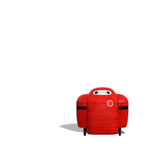

<h1 align="center">
  
</h1>

**Software Engineering Student | Junior Developer** 🇨🇷

## 🧑‍💻 About Me

- 🎓 Software Engineering student at **UTN**
- 🔍 Interested in algorithms, data structures, and system design
- 🛠️ Building personal projects to strengthen my **backend** and **database** skills
- 💡 Every challenge is a chance to grow

 

:fire: **Languages and Tools:**

<code></code>
<code></code>
<code></code>
<code></code>
<code></code>
 
<code></code>
<code></code>
<code></code>
<code></code>
<code></code>

---

## 📊 GitHub Stats

  

  

---

## 📬 Contact

  
  

---

<i>🔧 Building one commit at a time.</i>

<b>"If you can imagine it, you can program it."</b>

